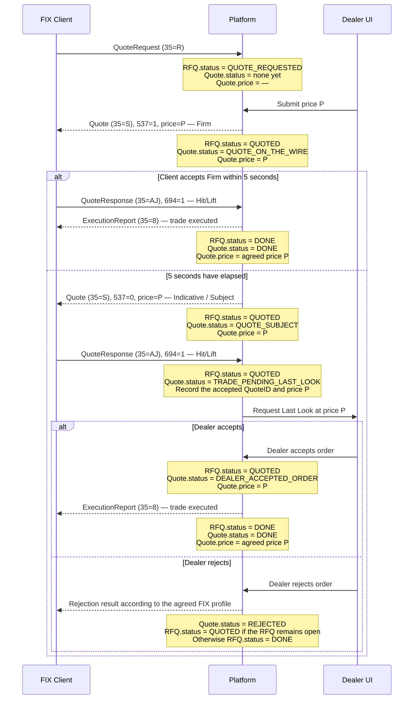
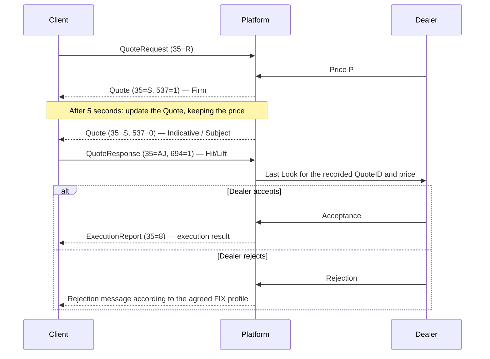
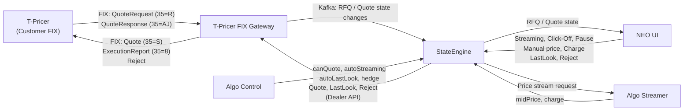

	

	
### Rfq.status:	
	
| Status | Description | Price |
|---|---|---|
| `QUOTE_REQUESTED` | The client submitted an RFQ; there is no active quote yet. | Not set |
| `QUOTED` | The dealer published a quote. This status remains while the request is open, including during Subject and Last Look. | Current quote price |
| `DONE` | The RFQ is complete: a trade was executed or the request was closed without a trade. Store the completion reason separately, for example `TRADED`, `REJECTED`, `PASSED`, or `EXPIRED`. | Trade price, if a trade was executed |	

### Quote.staus
| Status | Description | Price |
|---|---|---|
| `QUOTE_ON_THE_WIRE` | An active firm quote. If the client accepts it, execution proceeds without Last Look. | Most recently published price |
| `QUOTE_SUBJECT` | An active indicative quote. If the client accepts it, the dealer’s Last Look process begins. | Most recently published price |
| `TRADE_PENDING_LAST_LOOK` | The client accepted the Subject quote; the dealer must accept or reject the request. Record the accepted price and `QuoteID`. | Price accepted by the client |
| `DEALER_ACCEPTED_ORDER` | The dealer accepted the request after Last Look; execution is pending completion. | Agreed price |
| `DONE` | The quote has completed with an executed trade. | Executed price |
| `REJECTED` | The dealer rejected Last Look for this quote version. If the RFQ is still open, the dealer may publish a new quote version. | Price of the rejected quote |

