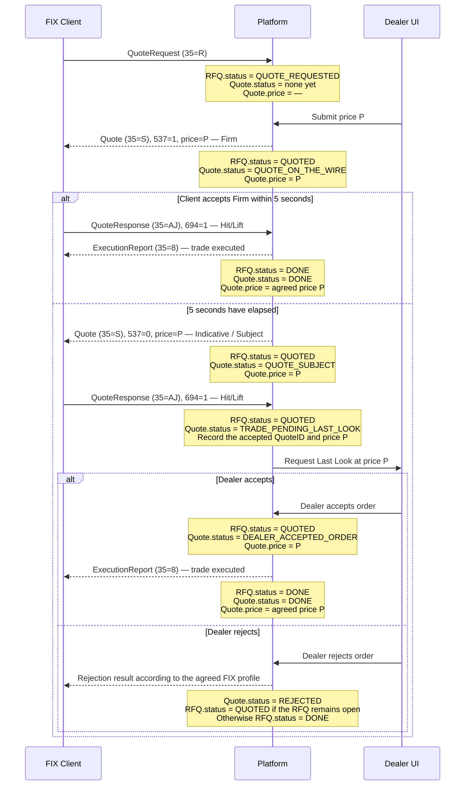
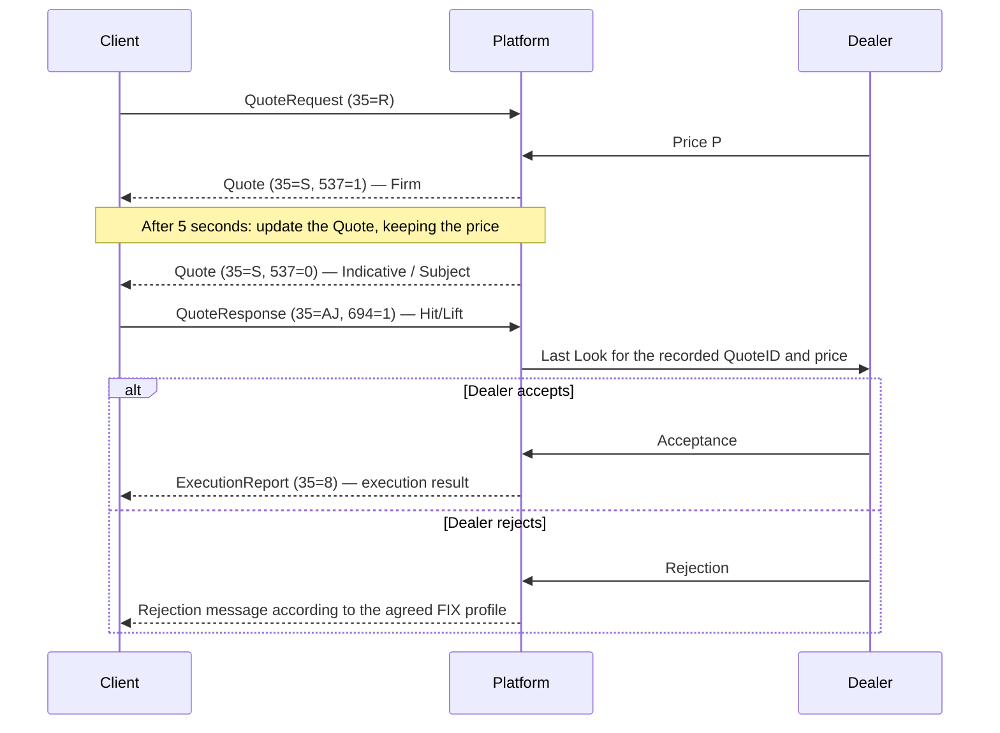

	

	
### Rfq.status:	
	
| Status | Description | Price |
|---|---|---|
| `QUOTE_REQUESTED` | The client submitted an RFQ; there is no active quote yet. | Not set |
| `QUOTED` | The dealer published a quote. This status remains while the request is open, including during Subject and Last Look. | Current quote price |
| `DONE` | The RFQ is complete: a trade was executed or the request was closed without a trade. Store the completion reason separately, for example `TRADED`, `REJECTED`, `PASSED`, or `EXPIRED`. | Trade price, if a trade was executed |	


### Quote.staus
| Status | Description | Price |
|---|---|---|
| `QUOTE_ON_THE_WIRE` | An active firm quote. If the client accepts it, execution proceeds without Last Look. | Most recently published price |
| `QUOTE_SUBJECT` | An active indicative quote. If the client accepts it, the dealer’s Last Look process begins. | Most recently published price |
| `TRADE_PENDING_LAST_LOOK` | The client accepted the Subject quote; the dealer must accept or reject the request. Record the accepted price and `QuoteID`. | Price accepted by the client |
| `DEALER_ACCEPTED_ORDER` | The dealer accepted the request after Last Look; execution is pending completion. | Agreed price |


sequenceDiagram
    participant TP as T-Pricer — клиент FIX
    participant GW as T-Pricer FIX Gateway
    participant SE as StateEngine
    participant AS as Algo Streamer
    participant AC as Algo Control
    participant UI as NEO UI

    UI->>AC: Обновить режим, canQuote, autoStreaming, autoLastLook, hedge, charge или manualPrice
    AC-->>SE: Изменение Algo Control

    TP->>GW: QuoteRequest (35=R)
    GW-->>SE: RFQ state change — событие состояния RFQ
    GW-->>UI: RFQ для отображения в дилерском UI

    SE->>AS: Запрос streaming цены для RFQ

    loop При каждом тике
        AS-->>SE: midPrice, charge
        SE->>SE: Сохранить тик для аудита и выбрать цену
        Note over SE: Algo: midPrice ± charge с учётом стороны<br/>Manual: цена, введённая дилером

        opt Публикация разрешена и режим допускает обновление
            SE->>GW: Dealer API — quote(price, PriceSource, QuoteType)
            GW-->>TP: Quote (35=S), 537=1 или 0, price=P
            GW-->>SE: Фактически отправленное состояние Quote
            GW-->>UI: Обновление Quote в дилерском UI
        end
    end

    Note over GW,TP: 537=1 — Firm / QuoteOnTheWire<br/>537=0 — Indicative / QuoteSubject

    alt Клиент принимает Firm до истечения 5 секунд
        TP->>GW: QuoteResponse (35=AJ), 694=1 — Hit/Lift
        GW-->>TP: ExecutionReport (35=8) — результат сделки
        GW-->>SE: RFQ.status= DONE; Quote.status= DONE
        GW-->>UI: Обновлённое состояние RFQ и Quote

    else Firm-котировка остаётся активной 5 секунд
        SE->>GW: Dealer API — обновить Quote до Indicative
        GW-->>TP: Quote (35=S), 537=0, цена P
        GW-->>SE: RFQ.status= QUOTED; Quote.status= QUOTE_SUBJECT
        GW-->>UI: QuoteSubject, цена P

        TP->>GW: QuoteResponse (35=AJ), 694=1 — Hit/Lift
        GW-->>SE: Quote.status= TRADE_PENDING_LAST_LOOK
        Note over GW,SE: Зафиксировать QuoteID и принятую клиентом цену

        alt autoLastLook=true
            SE->>GW: Dealer API — Last Look accept
        else autoLastLook=false
            UI->>GW: Dealer API — решение дилера по Last Look
        end

        alt Дилер принимает
            GW-->>SE: Quote.status= DEALER_ACCEPTED_ORDER
            GW-->>TP: ExecutionReport (35=8) — результат сделки
            GW-->>SE: RFQ.status= DONE; Quote.status= DONE
            GW-->>UI: Обновлённое состояние RFQ и Quote
        else Дилер отклоняет
            UI->>GW: Dealer API — Last Look reject
            GW-->>TP: FIX-ответ об отказе по согласованному профилю
            GW-->>SE: Quote.status= REJECTED
            Note over GW,SE: RFQ остаётся QUOTED, если запрос открыт для новой котировки
            GW-->>UI: Обновлённое состояние RFQ и Quote
        end
    end

    opt Дилер отклоняет RFQ или активную котировку
        UI->>GW: Dealer API — reject RFQ/Quote
        GW-->>TP: FIX-ответ об отказе по согласованному профилю
        GW-->>SE: Обновлённое состояние RFQ и Quote
    end
```	
| `DONE` | The quote has completed with an executed trade. | Executed price |
| `REJECTED` | The dealer rejected Last Look for this quote version. If the RFQ is still open, the dealer may publish a new quote version. | Price of the rejected quote |
